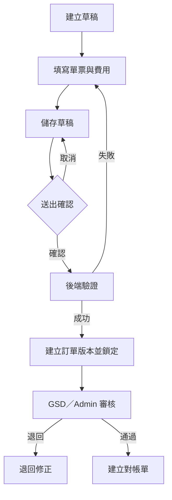
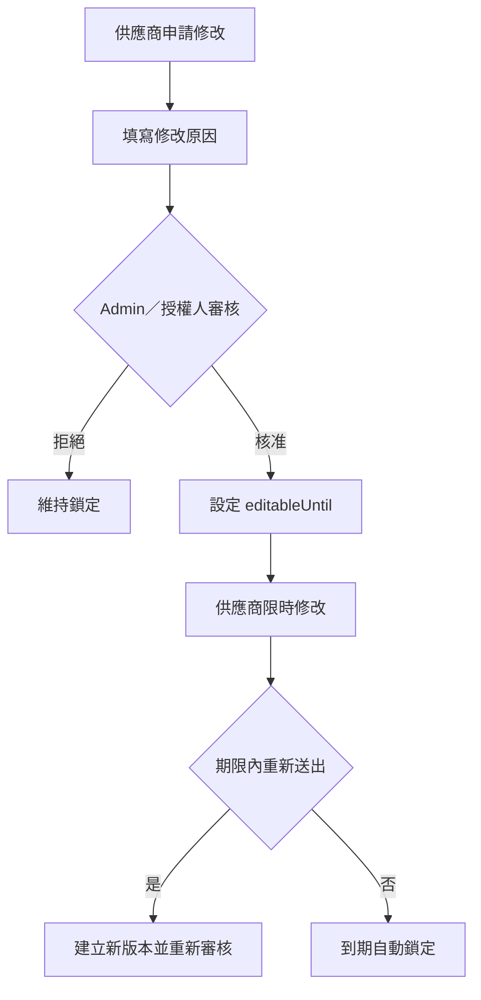
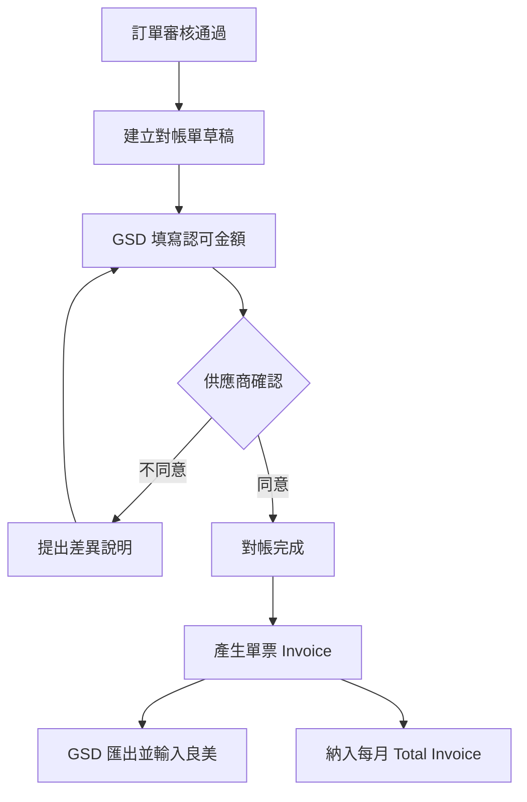

# Vendor 供應商對帳系統－開發規格與 Codex 執行文件

> 文件版本：0.1（需求草案）  
> 目標日期：2026-10-08  
> 使用方式：將本檔放在專案根目錄，交由 Codex 閱讀後分階段執行。  
> 重要限制：本文件仍有標示 `[TBD]` 的需求。Codex 不得自行猜測帳務或權限規則，也不得將未經資安、帳務及使用者驗收的版本宣稱為正式上線版本。

---

## 1. 專案目的

建立一套供外部供應商使用的 Vendor 網站，讓供應商能夠：

1. 使用公司預先建立的帳號登入。
2. 建立物流單票／費用訂單。
3. 逐筆輸入費用、幣別及稅別資料。
4. 上傳帳務附件。
5. 送出訂單並在規定時間內申請修改。
6. 與公司 GSD／後台人員完成單票對帳。
7. 查看自己的對帳結果及 Invoice。

公司內部人員需要能夠：

1. 管理供應商公司與帳號。
2. 查看授權範圍內的供應商訂單。
3. 審核訂單及費用。
4. 核准或拒絕修改申請。
5. 產生單票 Invoice。
6. 依月份、供應商、公司及幣別彙總 Total Invoice。
7. 匯出資料，供 GSD 人員逐筆輸入良美系統。
8. 保留完整操作與修改紀錄。

---

## 2. 專案範圍與開發原則

### 2.1 第一階段 MVP 必做

- 登入／登出
- 供應商公司與使用者管理
- 角色及權限
- 供應商資料隔離
- 訂單草稿、送出及查詢
- 單票資料與費用明細
- 附件上傳
- 訂單鎖定
- 修改申請、審核及限時開放
- 單票對帳
- 單票 Invoice
- Excel／CSV 匯出
- Audit Log

### 2.2 第二階段

- 發貨列表及發貨狀態
- 每月 Total Invoice
- PDF Invoice
- Email 通知
- 批次處理
- 管理報表
- 良美系統整合或匯入格式優化

### 2.3 暫不納入

- 線上付款
- 自動換匯或匯率交易
- 手機 App
- 未經公司確認的良美系統直接 API 串接
- 讓 Codex 自動處理正式主機、網域、憑證或正式帳號密碼

---

## 3. 角色定義

| 角色代碼 | 中文名稱 | 說明 |
|---|---|---|
| `SUPPLIER_USER` | 供應商使用者 | 只能操作及查看自己供應商公司的資料 |
| `EMPLOYEE` | 公司員工 | 只能查看或處理被指派的資料；實際範圍 `[TBD]` |
| `GSD` | GSD 帳務人員 | 審核、對帳、產生及匯出 Invoice |
| `ADMIN` | 後台管理人員 | 管理供應商、帳號、權限、訂單與修改申請 |
| `SYSTEM_ADMIN` | 系統管理者 | 維護系統設定及技術作業，不應任意修改帳務資料 |

不得在程式內寫死 Anita、Mini、Jason 等人名。應建立角色與權限，再將人員帳號指派到角色。

---

## 4. 核心業務定義

### 4.1 原始訂單、對帳單及 Invoice

系統不得在送出後建立兩筆互不關聯的訂單。正確關係為：

```text
Order 原始訂單
  └─ Reconciliation 對帳單
       └─ Invoice 單票帳單
            └─ Monthly Statement / Total Invoice 月結帳單
```

- `Order`：供應商申報的物流單票及費用。
- `Reconciliation`：比較供應商申報金額與公司認可金額。
- `Invoice`：完成對帳後的正式請款結果。
- `Monthly Statement`：依供應商、公司、月份及幣別彙總已確認的單票 Invoice。

Admin 與 Supplier User 可以看到同一筆 Order，但畫面及可操作欄位不同，不是各自擁有一筆訂單。

### 4.2 訂單流程



### 4.3 修改流程



Invoice 產生或月結關閉後，不得直接修改原訂單。差額應使用 Debit Note、Credit Note 或 Adjustment 處理。

### 4.4 對帳流程



---

## 5. 狀態設計

### 5.1 Order 狀態

| 狀態 | 說明 |
|---|---|
| `DRAFT` | 草稿，可由建立者編輯 |
| `SUBMITTED` | 已送出，等待審核 |
| `UNDER_REVIEW` | GSD／Admin 審核中 |
| `REJECTED` | 退回修正 |
| `LOCKED` | 已鎖定 |
| `UNLOCK_REQUESTED` | 已提出修改申請 |
| `EDITABLE` | 經核准、限時開放 |
| `RESUBMITTED` | 修改後重新送出 |
| `RECONCILED` | 已完成對帳 |
| `INVOICED` | 已產生 Invoice |
| `MONTH_CLOSED` | 已納入月結，不得修改 |
| `CANCELLED` | 已取消，資料仍需保留 |

### 5.2 Reconciliation 狀態

- `DRAFT`
- `WAITING_SUPPLIER_CONFIRMATION`
- `DISPUTED`
- `CONFIRMED`
- `INVOICED`
- `VOIDED`

### 5.3 Modification Request 狀態

- `PENDING`
- `APPROVED`
- `REJECTED`
- `EXPIRED`
- `COMPLETED`

---

## 6. 權限矩陣

| 功能 | Supplier User | Employee | GSD | Admin |
|---|---:|---:|---:|---:|
| 建立自己公司的訂單 | 是 | 依指派 | 是 | 是 |
| 儲存草稿 | 自己建立 | 依指派 | 是 | 是 |
| 查詢訂單 | 自己公司 | 依指派 | 授權範圍 | 全部 |
| 編輯草稿 | 自己建立 | 依指派 | 是 | 是 |
| 編輯已送出訂單 | 需核准 | 需授權 | 依權限 | 是 |
| 提出修改申請 | 是 | 依權限 | 是 | 不需要 |
| 核准修改 | 否 | 否 | `[TBD]` | 是 |
| 取消訂單 | 提出申請 | 提出申請 | 依權限 | 是 |
| 上傳附件 | 自己訂單 | 依指派 | 是 | 是 |
| 查看對帳單 | 自己公司 | 依指派 | 是 | 是 |
| 填寫公司認可金額 | 否 | 否 | 是 | 是 |
| 確認對帳 | 自己公司 | 否 | 是 | 是 |
| 產生 Invoice | 否 | 否 | 是 | 是 |
| 匯出／列印 | `[TBD]` | 依權限 | 是 | 是 |
| 管理供應商及帳號 | 否 | 否 | 否 | 是 |

「返回」不屬於權限項目。所有登入使用者都可以返回上一頁。

---

## 7. 頁面與路由

### 7.1 公開頁面

| 路由 | 頁面 |
|---|---|
| `/login` | 登入 |
| `/forgot-password` | 忘記密碼 `[TBD]` |
| `/reset-password` | 重設密碼 `[TBD]` |

### 7.2 Supplier User

| 路由 | 頁面 |
|---|---|
| `/dashboard` | 首頁 |
| `/orders` | 自己公司的訂單列表 |
| `/orders/new` | 建立訂單 |
| `/orders/:id` | 訂單明細 |
| `/orders/:id/edit` | 編輯草稿或限時修改 |
| `/orders/:id/change-request` | 申請修改 |
| `/reconciliations` | 對帳單列表 |
| `/reconciliations/:id` | 對帳及確認 |
| `/invoices` | Invoice 列表 |
| `/profile` | 個人資料 |

### 7.3 Admin／GSD

| 路由 | 頁面 |
|---|---|
| `/admin/dashboard` | 後台首頁 |
| `/admin/orders` | 全部／授權訂單 |
| `/admin/orders/:id` | 訂單審核 |
| `/admin/change-requests` | 修改申請列表 |
| `/admin/reconciliations` | 對帳管理 |
| `/admin/invoices` | Invoice 管理 |
| `/admin/monthly-statements` | 月結管理 |
| `/admin/companies` | 供應商公司管理 |
| `/admin/users` | 使用者管理 |
| `/admin/roles` | 角色權限管理 |
| `/admin/audit-logs` | 操作紀錄 |

Sidebar 必須依角色顯示，但後端仍要再次驗證權限；隱藏選單不代表具備安全性。

---

## 8. 表單欄位

### 8.1 Supplier Company

- companyCode
- Chinese name `[TBD 是否需要]`
- English name
- shortName
- country／region
- address
- taxId `[TBD]`
- defaultCurrency
- reconciliationDay
- paymentDay
- contactName
- contactEmail
- contactPhone
- status
- note

銀行帳戶資料只有在帳務確認需要時才加入，且必須限制權限及加密／遮罩顯示。

### 8.2 User

- username
- displayName
- email
- phone `[TBD]`
- companyId
- roleIds
- status
- passwordHash
- lastLoginAt
- createdAt
- updatedAt

### 8.3 Order Header

- orderNumber（系統產生）
- companyId
- customerCode／customerName
- supplierCode／supplierName
- invoiceDate
- fileNumber
- vesselName
- voyageNumber
- mblNumber
- hblNumber
- containerNumber
- containerQuantity `[TBD]`
- containerType `[TBD]`
- origin
- destination
- country
- note（最多 1000 字）
- status
- currentVersion
- submittedAt
- lockedAt
- createdBy

### 8.4 Order Charge Line

- orderId
- chargeCode
- chargeName
- quantity
- unit
- unitPrice
- currency
- taxType
- taxRate
- amountBeforeTax
- taxAmount
- amountAfterTax
- note

金額計算必須由後端重新計算，不能相信前端送來的合計值。

### 8.5 Reconciliation Line

- reconciliationId
- orderChargeLineId
- supplierClaimedAmount
- companyApprovedAmount
- differenceAmount
- differenceReason
- supplierConfirmed
- gsdConfirmed

### 8.6 Attachment

- ownerType（ORDER／RECONCILIATION／INVOICE）
- ownerId
- originalFilename
- storageKey
- mimeType
- fileSize
- uploadedBy
- uploadedAt

---

## 9. 資料模型

至少建立以下資料表：

- `companies`
- `users`
- `roles`
- `permissions`
- `user_roles`
- `orders`
- `order_versions`
- `order_charge_lines`
- `charge_item_master`
- `tax_rule_master`
- `currencies`
- `modification_requests`
- `reconciliations`
- `reconciliation_lines`
- `invoices`
- `invoice_lines`
- `monthly_statements`
- `monthly_statement_invoices`
- `attachments`
- `audit_logs`

### 9.1 必要關聯

```text
Company 1 ── N User
Company 1 ── N Order
Order 1 ── N OrderVersion
Order 1 ── N OrderChargeLine
Order 1 ── N ModificationRequest
Order 1 ── 0..N Reconciliation
Reconciliation 1 ── N ReconciliationLine
Reconciliation 1 ── 0..1 Invoice
MonthlyStatement N ── N Invoice
```

每一筆屬於供應商的資料都必須包含 `companyId`，後端查詢不得只依前端傳入的 companyId 判斷權限。

---

## 10. API 草案

### 10.1 Authentication

- `POST /auth/login`
- `POST /auth/logout`
- `GET /auth/me`
- `POST /auth/forgot-password` `[TBD]`
- `POST /auth/reset-password` `[TBD]`

### 10.2 Companies and Users

- `GET /admin/companies`
- `POST /admin/companies`
- `GET /admin/companies/:id`
- `PATCH /admin/companies/:id`
- `GET /admin/users`
- `POST /admin/users`
- `PATCH /admin/users/:id`
- `POST /admin/users/:id/disable`

### 10.3 Orders

- `GET /orders`
- `POST /orders`
- `GET /orders/:id`
- `PATCH /orders/:id`
- `POST /orders/:id/submit`
- `POST /orders/:id/cancel-request`
- `POST /orders/:id/attachments`

### 10.4 Modification Requests

- `POST /orders/:id/modification-requests`
- `GET /admin/modification-requests`
- `POST /admin/modification-requests/:id/approve`
- `POST /admin/modification-requests/:id/reject`
- `POST /orders/:id/resubmit`

### 10.5 Reconciliation

- `GET /reconciliations`
- `POST /admin/orders/:id/reconciliations`
- `GET /reconciliations/:id`
- `PATCH /admin/reconciliations/:id`
- `POST /reconciliations/:id/supplier-confirm`
- `POST /reconciliations/:id/dispute`
- `POST /admin/reconciliations/:id/confirm`

### 10.6 Invoice and Export

- `POST /admin/reconciliations/:id/invoice`
- `GET /invoices`
- `GET /invoices/:id`
- `GET /admin/invoices/export?format=xlsx`
- `POST /admin/monthly-statements/generate`
- `GET /admin/monthly-statements/:id/export`
- `POST /admin/invoices/:id/mark-posted-to-liangmei`

所有敏感 API 必須在後端檢查 Authentication、Role、Permission、companyId、資料狀態及時間限制。

---

## 11. 建議技術架構

### 11.1 正式架構

| 部分 | 技術 |
|---|---|
| 前端 | Next.js、React、TypeScript |
| 樣式 | Tailwind CSS |
| 表單 | React Hook Form、Zod |
| 表格 | TanStack Table |
| API 狀態 | TanStack Query |
| 後端 | NestJS、TypeScript |
| API 規格 | REST、OpenAPI／Swagger |
| 資料庫 | PostgreSQL |
| ORM | Prisma |
| 驗證／授權 | NestJS Passport／Guards、RBAC |
| 密碼 | Argon2 |
| 本機附件 | MinIO 或本機開發儲存 |
| 正式附件 | S3 相容儲存或 Azure Blob |
| 背景工作 | Redis、BullMQ（第二階段） |
| Excel | ExcelJS |
| PDF | Puppeteer 或 pdf-lib |
| 單元測試 | Jest／Vitest |
| API 測試 | Supertest |
| 瀏覽器測試 | Playwright |
| 容器 | Docker／Docker Compose |
| CI/CD | GitHub Actions |
| 錯誤監控 | Sentry（正式環境） |

### 11.2 專案目錄

```text
vendor-portal/
├─ VENDOR_SYSTEM_SPEC.md
├─ AGENTS.md
├─ package.json
├─ pnpm-workspace.yaml
├─ docker-compose.yml
├─ .env.example
├─ apps/
│  ├─ web/                 # Next.js
│  └─ api/                 # NestJS
├─ packages/
│  ├─ contracts/           # 共用 TypeScript 型別及 Zod schema
│  ├─ eslint-config/
│  └─ tsconfig/
├─ prisma/
│  ├─ schema.prisma
│  └─ migrations/
└─ docs/
   ├─ api.md
   ├─ permissions.md
   └─ decisions.md
```

若只建立前端原型，允許先使用 Next.js Mock API／假資料；但不得將該版本稱為正式系統，也不得放入真實供應商或帳務資料。

---

## 12. 安全及非功能需求

1. 密碼不得明文儲存、寫入程式或提交 Git。
2. Session 使用 HttpOnly、Secure、SameSite Cookie。
3. 正式環境強制 HTTPS。
4. 供應商只能讀寫自己 companyId 的資料。
5. 後端不得信任前端傳入的角色、companyId、金額合計或鎖定時間。
6. 訂單、對帳及 Invoice 不使用永久刪除，改用狀態與 Audit Log。
7. 附件必須限制副檔名、MIME、檔案大小及下載權限。
8. 正式附件需考慮病毒掃描。
9. 所有時間以伺服器時間判斷，資料庫保存 UTC，畫面顯示公司時區。
10. 金額使用 Decimal，不使用 JavaScript 浮點數直接計算帳務。
11. 不同幣別不得直接加總。
12. 資料庫定期備份並驗證還原流程。
13. 登入失敗需限制重試次數。
14. Audit Log 至少保存操作者、時間、IP、動作、資料類型、資料ID及修改前後內容。

---

## 13. 驗收條件

### 13.1 Authentication

- Admin 可建立供應商帳號。
- 停用帳號不能登入。
- Supplier User 登入後只能看到自己的公司資料。
- 直接修改網址或 API 參數也不能看到其他供應商資料。

### 13.2 Order

- User 可建立及儲存草稿。
- 缺少必填欄位時不能送出。
- Submit 前必須再次確認。
- Submit 後產生唯一訂單編號及版本。
- 已鎖定訂單不能直接修改。
- 費用合計由後端重新計算。

### 13.3 Modification

- User 必須填寫修改原因。
- 未核准前不能修改。
- 核准後只有 `editableUntil` 前可以修改。
- 到期後即使直接呼叫 API 也不能修改。
- 修改後保留舊版本。

### 13.4 Reconciliation and Invoice

- 對帳單引用原 Order，不建立第二筆獨立 Order。
- 可顯示申報金額、認可金額及差異。
- 差異必須填寫原因。
- 對帳完成前不能產生正式 Invoice。
- Invoice 產生後不得直接改寫原金額。
- Total Invoice 必須依供應商、月份、公司及幣別分組。

### 13.5 Audit and Export

- 關鍵操作均可查詢 Audit Log。
- GSD／Admin 可匯出 Excel／CSV。
- 匯出金額與系統畫面一致。
- 可標記輸入良美系統的人員及時間。

---

## 14. 待確認需求（開發阻擋項目）

Codex 遇到下列項目時必須停止該功能並詢問，不得自行猜測：

1. User 個人及公司資料的必要欄位。
2. User 是否可以自行建立訂單，或只有 Admin／GSD 可新增。
3. Order 代表物流單票、供應商請款單，或兩者合併。
4. 船名航次、MBL、HBL、櫃號是否全部必填。
5. 一張 Order 是否可以包含多個櫃號。
6. 可修改期限從 Submit 還是 Approve 開始計算。
7. 可修改期限為幾小時或幾個工作日。
8. GSD 是否可以核准修改，或只有 Admin。
9. Employee 的查詢及編輯範圍。
10. 費用名目完整清單。
11. 稅率、免稅、零稅及含稅／未稅計算規則。
12. 金額小數位及四捨五入方式。
13. Debit Note、Credit Note、Outstanding 的定義。
14. 對帳由誰先確認。
15. Invoice 編號規則及公司格式。
16. 月結截止日及跨月修改規則。
17. 不同幣別是否各產生一份 Total Invoice。
18. 匯率來源及換算日期（如需要換匯）。
19. Supplier User 是否可下載／列印自己的 Invoice。
20. 附件允許格式、數量及大小。
21. 良美系統目前只能人工輸入，還是提供匯入或 API。

---

## 15. Codex 分階段執行順序

### Phase 0：需求確認

Codex 任務：

1. 閱讀整份文件。
2. 列出 `[TBD]` 與互相矛盾的需求。
3. 不寫功能程式。
4. 產生 `docs/decisions.md`，記錄已確認與未確認事項。

完成條件：核心 Order、權限、時間限制、稅額及 Invoice 規則獲得確認。

### Phase 1：前端原型

建立：

- 登入畫面
- Supplier Dashboard
- 訂單列表
- 建立／編輯訂單
- 費用明細表格
- 送出確認視窗
- 修改申請畫面
- 對帳單畫面
- Admin 訂單審核畫面

限制：使用假資料，不做正式登入、付款或部署。

### Phase 2：後端與資料庫

建立：

- PostgreSQL Docker 開發環境
- Prisma Schema 及 Migration
- NestJS API
- Authentication
- RBAC
- companyId 資料隔離
- 測試種子資料

### Phase 3：Order 與修改流程

建立：

- Order CRUD
- Order Charge Lines
- Submit Transaction
- Order Version
- Locking
- Modification Request
- editableUntil 後端檢查
- Audit Log

### Phase 4：對帳及 Invoice

建立：

- Reconciliation
- Supplier Confirmation
- Invoice
- Excel／CSV Export
- Monthly Statement
- 良美輸入狀態

### Phase 5：測試及正式化

由有經驗工程師、帳務人員及資訊安全人員共同執行：

- 權限測試
- 資料隔離測試
- 帳務計算測試
- 附件安全測試
- 備份及還原測試
- UAT
- 正式環境部署
- HTTPS、網域及監控

---

## 16. 在家中 Codex 的建議開場指令

### 第一次執行

```text
請先完整閱讀 VENDOR_SYSTEM_SPEC.md。
目前只執行 Phase 0，不要寫程式、不要安裝套件、不要部署。
請列出：
1. 已確認的需求
2. 尚未確認的需求
3. 互相矛盾的規則
4. 需要由 Anita、Mini、GSD 或 Admin 回答的問題
5. 建議的 MVP 範圍
完成後等待我確認。
```

### Phase 1 前端原型

```text
請閱讀 VENDOR_SYSTEM_SPEC.md 與 docs/decisions.md。
只執行 Phase 1 前端原型，使用 Next.js、React、TypeScript、Tailwind CSS、React Hook Form 與 Zod。
使用假資料，不建立正式帳號、不使用真實供應商資料、不部署。
開始前先列出執行計畫與頁面清單；每完成一個頁面就執行格式檢查、型別檢查及測試。
```

### Phase 2 之後

```text
請先確認 VENDOR_SYSTEM_SPEC.md 所有與本階段有關的 TBD 已在 docs/decisions.md 定案。
若仍有未確認的帳務、權限或時間規則，停止相關功能並向我提問，不得自行假設。
只執行指定 Phase，完成後提供測試結果、已知限制、尚未完成項目及下一階段風險。
```

---

## 17. Codex 工作規則

1. 每次只執行一個 Phase。
2. 不得因為畫面完成就宣稱系統可正式上線。
3. 不得在程式、測試、截圖或 Git 中放入真實密碼、帳務或供應商個資。
4. 所有資料庫修改都要使用 Migration。
5. 所有 API 都要有權限測試。
6. 所有金額及稅額規則都要有單元測試。
7. 所有訂單狀態轉換都要在後端驗證。
8. 不得真正刪除帳務資料。
9. 不得繞過測試或關閉安全檢查以求快速完成。
10. 部署、網域、憑證、正式資料庫及正式帳號設定，必須另由有權限且具經驗的人員確認。

---

## 18. 目前可判定的責任分工

### 梁承恩／Leon 可負責

- 整理需求及流程
- 確認頁面欄位
- React／Next.js 前端原型
- 表單驗證
- 假資料及操作流程展示
- 與 Anita、Mini、GSD 確認規則
- UAT 測試案例
- 操作手冊

### 需要有經驗人員負責或覆核

- 帳號及密碼安全
- 後端授權與供應商資料隔離
- PostgreSQL 正式架構
- 帳務及稅額計算
- Invoice 正式格式
- Audit Log 完整性
- 附件安全
- 主機、網域、HTTPS、備份及監控
- 正式上線核准

---

## 19. 正式上線判定

只有在下列項目全部完成後，才可稱為正式上線：

- 核心 TBD 已定案
- UAT 通過
- 權限與跨供應商資料隔離測試通過
- 帳務及稅額計算核對通過
- 附件安全測試通過
- 備份與還原測試通過
- HTTPS、監控及錯誤通報完成
- 公司指定負責人書面核准

若 2026-10-08 前只能完成畫面、假資料或內部測試，應稱為「MVP 試行版」或「內部測試版」，不得稱為完整正式上線。
